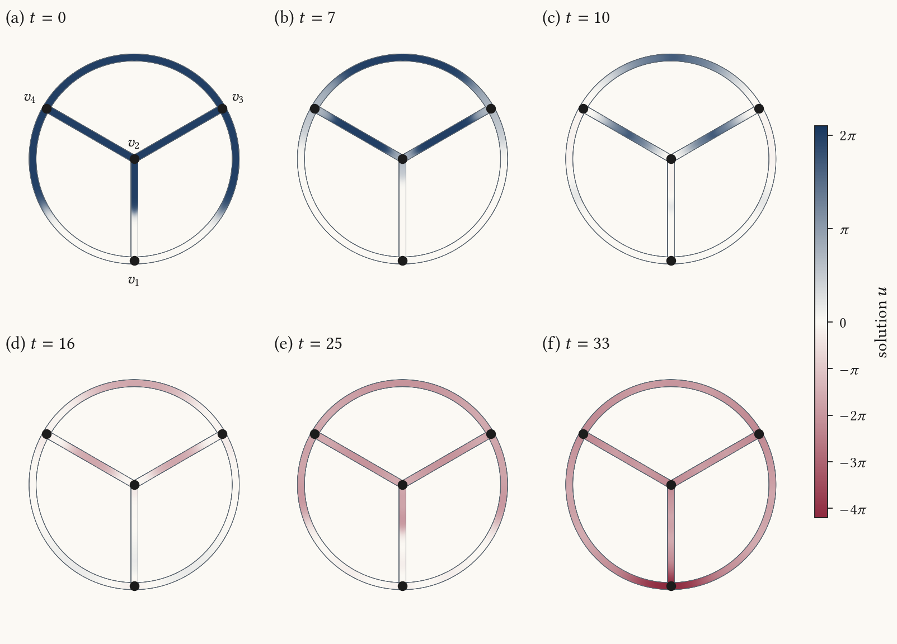

<!-- Author: Dr. Denys Dutykh (Mathematics Department, Khalifa University of Science and Technology, Abu Dhabi, UAE) -->

# sineGordonGraph: the sine-Gordon equation on a network, by a leapfrog finite-difference scheme



The run of `matlab/run_graph.m` as shipped, at t = 0, 7, 10, 16, 25 and 33, drawn as the script draws it: the graph
seen from above, each edge coloured by the solution u, on one colour scale for all panels (white at u = 0, darkening to
navy at 2π and to wine at −4π). Three kinks of speed 0.95 start in the middle of the three edges that meet at the vertex
v₁ (a) and run away from it; each one splits at the vertex it reaches into two kinks, one on each of the two other edges
there, so that six kinks travel towards the middles of the three edges joining v₂, v₃ and v₄ (b, c). There they pass
through each other and leave behind the value −2π instead of 2π (d); the kinks merge again at v₂, v₃ and v₄ and come
back to v₁ along the three edges that meet there (e), and collide at v₁ near t = 31, after which the value there falls
to about −4π and three new kinks run away from it (f). Every edge has length 10 in the computation; the drawing puts v₂
at the centre of a circle of radius 10 and the three other vertices on it, so that the arcs are drawn longer than they
are.

The MATLAB code sineGordonGraph solves the sine-Gordon equation on a network, a graph whose edges are segments on which
the equation holds and whose vertices join them, with the continuity of the solution and Kirchhoff's condition at every
vertex. Each edge carries a uniform lattice; the equation is advanced in time by the explicit leapfrog scheme at the
inner nodes, and the value at each vertex is the mean of the values at the nearest nodes of the edges that meet there,
the discrete form of the two vertex conditions. The script `run_graph.m` computes three kinks on a graph of four vertices
and six edges and draws the solution as it evolves. The method and its derivation from the Hamiltonian structure of the
equation are those of the article by Denys Dutykh and Jean-Guy Caputo in Applied Numerical Mathematics (2018), cited
below.

## The problem

On every edge, a segment 0 ⩽ x ⩽ ℓ oriented from its first vertex to its second, the solution u(x, t) obeys the
sine-Gordon equation, and at every vertex the edges that meet there are joined by two conditions:

```text
∂²u/∂t² − ∂²u/∂x² + sin u = 0                    on every edge, for t ⩾ 0,

u takes the same value on all the edges that meet at a vertex,
Σ ∂u/∂n = 0                                      at every vertex,
```

where the sum runs over the edges that meet at the vertex and ∂u/∂n is the derivative along each of them, away from
the vertex (Kirchhoff's law of currents). The kinks are the travelling waves

```text
u(x, t) = 4 arctan exp(γ (x − x₀ − c t)),        γ = 1/√(1 − c²),        0 ⩽ c < 1,
```

which join the states 0 and 2π and carry the energy 8γ.

The graph of `run_graph.m` has the four vertices v₁, v₂, v₃, v₄ and the six edges e₁ = (v₁, v₂), e₂ = (v₂, v₃),
e₃ = (v₂, v₄), e₄ = (v₃, v₄), e₅ = (v₄, v₁) and e₆ = (v₁, v₃): every vertex is joined to the three others, and every
edge has the length ℓ = 10. Each edge carries N = 500 nodes `x_j = (j − 1)Δx`, with Δx = ℓ/(N − 1) ≈ 0.02, and the
time step is Δt = 0.01. At the inner nodes 2 ⩽ j ⩽ N − 1 of every edge, the solution is advanced by the leapfrog scheme

```text
u_j(n+1) = 2 u_j(n) − u_j(n−1) + (Δt/Δx)² (u_(j+1)(n) − 2 u_j(n) + u_(j−1)(n)) − Δt² sin u_j(n),
```

where `u_j(n)` approximates `u(x_j, nΔt)`. Before every step, the value at each vertex is set, on every edge that meets
there, to the mean of the values at the nodes next to the vertex on these edges:

```text
u_v = (u_a + u_b + u_c)/3,        or equivalently        (u_a − u_v)/Δx + (u_b − u_v)/Δx + (u_c − u_v)/Δx = 0,
```

the discrete form of the two vertex conditions at a vertex where three edges meet. The article obtains this leapfrog
scheme from a symplectic Euler discretisation of the Hamiltonian lattice equations. At t = 0 and t = Δt the solution is
the exact kink of speed c = 0.95 centred at x₀ = x₂₅₀ ≈ 4.99 on the edges e₁, e₅ and e₆, oriented so that the three kinks
move away from v₁, and the constant 2π on the edges e₂, e₃ and e₄. The script performs 3300 steps, up to t = 33.

## Quick start

In MATLAB, from the folder `matlab/` (the script adds `tools/` to the path itself):

```matlab
cd matlab
run_graph
```

The script draws the initial condition, then advances the solution and redraws it after every five steps, up to
t = 33: each edge is drawn where it lies in the plane, coloured by the value of u, with the vertices as blue dots. With
the shipped parameters the run takes about a minute (MATLAB R2025b). The kinks of the second video below are obtained by
changing `c0 = 0.95` into `c0 = 0.5` at the line marked "kink's speed".

## A check of the run

The energy of the solution,

```text
E = Σ over the edges ∫₀^ℓ ( ½ (∂u/∂t)² + ½ (∂u/∂x)² + 1 − cos u ) dx,
```

is conserved by the sine-Gordon equation with these vertex conditions, and the three kinks of the initial condition
carry E ≈ 3 × 8γ = 24/√(1 − 0.95²) ≈ 76.8615. Computed from two consecutive time levels of the run (the trapezoidal rule
on every edge, the time derivative replaced by the difference of the two levels divided by Δt), the energy is 76.8562 at
the start, rises to 77.6801 (1.1 % above) when the kinks cross the vertices v₂, v₃ and v₄ near t = 5.3, and ends at
76.9586 at t = 33 (0.13 % above), close to the value 76.97 that the article reports at the end of its run; the scheme
is explicit and does not conserve the energy exactly, but it keeps it to about one per cent through the whole run.

## Videos

Four animations made with this code accompany the article on YouTube (click a picture to watch). The first shows three
kinks of speed 0.95, as in the figure; the second shows the same three kinks with the speed 0.5, too slow to cross the
vertices v₂, v₃ and v₄, so that they go back and forth on the three edges that meet at v₁.

[](https://youtu.be/rwZ4d_T7nTs)
[](https://youtu.be/CtglMe0IcBk)

The third animation shows a breather (an oscillating bound pair of a kink and an antikink) of speed 0.95 and frequency
√2/2, which starts on the edge e₁, is partly reflected at every vertex it reaches and sends a new breather into each of
the two other edges there; the fourth shows a weaker breather, which never crosses the vertex v₂ and stays on the edge
e₁. Both were computed with a breather as initial condition, which `run_graph.m` does not contain (the fourth also with
longer edges and a finer lattice): the script as shipped computes only the three kinks.

[](https://youtu.be/doKNMrOkrOo)
[](https://youtu.be/sncYZU-cbkY)

## Contents

The folder `matlab/` holds the script `run_graph.m` (parameters, graph, its drawing in the plane, initial condition and
time loop) and the function `Plot.m` it calls to draw one frame; the folder `matlab/tools/` holds the function
`cbrewer.m`, with `interpolate_cbrewer.m` and the table `colorbrewer.mat`, which gives `Plot.m` its colour map. The
folder `docs/figures/` holds the two scripts that make the figure of this page: `sgg_readme_data.m` (MATLAB or GNU
Octave) repeats the computation of `run_graph.m` without its drawing (in MATLAB their solutions at t = 33 are identical
to the last bit, in GNU Octave they agree to about 10⁻¹²) and writes the solution every 0.5 time units, with the energy
of every step, to `sgg_frames.mat`, and `plot_readme_figure.py` (Python 3 with NumPy, SciPy, Pillow and Matplotlib, and
the style file beside it) draws the figure from that file. Both are run from `docs/figures/`, in this order.

## Requirements

MATLAB, with no toolbox (checked with R2025b). GNU Octave stops `run_graph.m` at line 177,
`set(FigHandle, 'Renderer', 'zbuffer');`, since it knows no such renderer; with that line deleted, the rest of the
script runs in GNU Octave 11.1 (in about four minutes, most of them spent drawing). The script
`docs/figures/sgg_readme_data.m` runs in both.

## How to cite

If you use this code, please cite the article:

D. Dutykh and J.-G. Caputo, Wave dynamics on networks: method and application to the sine-Gordon equation, Applied
Numerical Mathematics 131, 54–71 (2018).

https://doi.org/10.1016/j.apnum.2018.03.010

```bibtex
@article{Dutykh2018,
  author = {Dutykh, Denys and Caputo, Jean-Guy},
  title = {Wave Dynamics on Networks: {{Method}} and Application to the Sine-{{Gordon}} Equation},
  journal = {Applied Numerical Mathematics},
  year = 2018,
  month = sep,
  volume = {131},
  pages = {54--71},
  doi = {10.1016/j.apnum.2018.03.010},
  eprint = {1506.02405},
  archiveprefix = {arXiv}
}
```

The button "Cite this repository" in the right-hand column of this page gives the same reference, read from
`CITATION.cff`. A free copy of the article is on arXiv:

https://arxiv.org/abs/1506.02405

## Licence

GNU General Public License, version 3 (see `LICENSE`). The functions `cbrewer.m` and `interpolate_cbrewer.m` of
`matlab/tools/`, with the table `colorbrewer.mat`, are the package cbrewer by Charles Robert (2011), once distributed on
the File Exchange of MATLAB Central; they include colour specifications and designs developed by Cynthia Brewer
([ColorBrewer](https://colorbrewer2.org/)), remain the work of their authors and are not covered by the licence of this
repository.

## Authors

Denys Dutykh (Mathematics Department, Khalifa University of Science and Technology, Abu Dhabi, UAE), with Jean-Guy
Caputo (Laboratoire de Mathématiques, INSA de Rouen), co-author of the article.

https://www.denys-dutykh.com/
